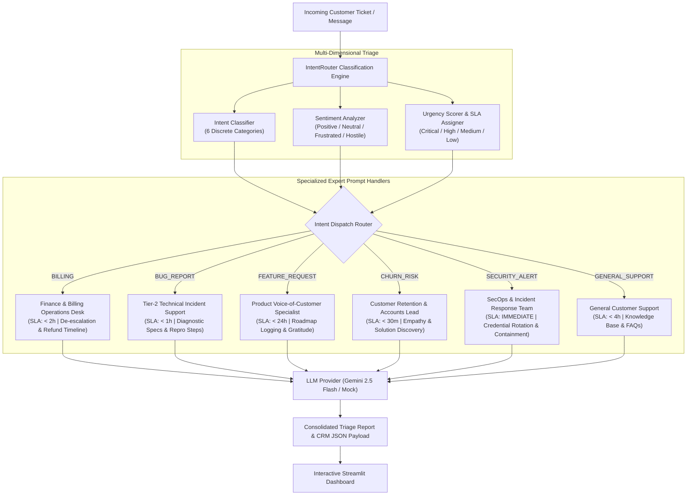

# 🚦 IntentRouter: Multi-Prompt Triage & Intent Classifier

[](https://www.python.org/downloads/)
[](https://docs.pydantic.dev/)
[](https://streamlit.io/)
[](https://pytest.org/)
[](LICENSE)

> **An intelligent multi-prompt routing and classification engine for SaaS customer support and workflow automation. Classifies incoming requests into discrete intent categories, evaluates urgency and sentiment, and dispatches queries to hyper-specialized expert prompts.**

---

## 📌 Overview & Core Problem

Monolithic "do-everything" system prompts fail in complex enterprise environments. When an AI agent attempts to simultaneously juggle billing refunds, technical stack trace investigations, delicate cancellation retention, and urgent security breaches within a single prompt, several critical failure modes occur:

1. **Instruction Confusion & Policy Drift:** A prompt instructed to be "supportive and flexible" will often promise unauthorized refunds or provide vague technical troubleshooting instead of gathering diagnostic specs.
2. **Missing SLA Prioritization:** Standard chat models treat a critical security incident or production checkout outage with the same urgency as a minor cosmetic feature suggestion.
3. **Impersonal & Robotic Responses:** Different customer intents demand completely distinct communication styles: billing disputes require reassuring de-escalation; security alerts require urgent, authoritative containment; feature suggestions require consultative gratitude.

**IntentRouter** eliminates monolithic prompt failure by introducing **intent-driven prompt routing**:
* **Real-Time Classification:** Evaluates incoming tickets across 6 distinct categories (`BILLING`, `BUG_REPORT`, `FEATURE_REQUEST`, `CHURN_RISK`, `SECURITY_ALERT`, `GENERAL_SUPPORT`).
* **Sentiment & Urgency Scoring:** Detects emotional temperature (`POSITIVE`, `NEUTRAL`, `FRUSTRATED`, `HOSTILE`) and assigns priority SLAs (`CRITICAL`, `HIGH`, `MEDIUM`, `LOW`).
* **Specialized Expert Prompt Dispatch:** Dynamically routes the inquiry to a tailored expert system prompt with customized tone, constraints, and diagnostic protocols.

---

## 🏗️ System Architecture



---

## ⚡ Key Engineering Features

| Component | Technical Implementation | Operational Reliability Value |
| :--- | :--- | :--- |
| **Intent Categorizer** | Multi-keyword and pattern-based classifier covering 6 enterprise SaaS categories. | Prevents prompt pollution by isolating specialized logic to dedicated expert prompts. |
| **Sentiment & Frustration Detector** | Regex trigger matrix recognizing hostile threats (e.g. legal action, fraud reports) and customer friction. | Flags at-risk customer interactions for instant supervisor visibility. |
| **Dynamic Urgency & SLA Triage** | Automated rules engine scoring inquiries from `LOW` to `CRITICAL` based on blast radius. | Guarantees critical security alerts and production outages bypass standard queues. |
| **Specialized Expert Handlers** | Dedicated system prompts with strict negative constraints, tone guidelines, and suggested metadata tags. | Produces hyper-tailored responses that sound like experienced domain specialists. |
| **Zero-Crash Mock Provider** | Offline mock engine simulating realistic domain-specific expert responses. | Enables full local verification and automated testing without external API dependencies. |

---

## 🚀 Quickstart Guide

### 1. Clone & Set Up Virtual Environment
```bash
git clone https://github.com/afsalkp007/intent-router.git
cd intent-router

# Create and activate virtual environment
python3 -m venv .venv
source .venv/bin/activate

# Install dependencies
pip install -r requirements.txt
```

### 2. Configure Environment (Optional for Live Gemini API)
```bash
cp .env.example .env
# Paste your GEMINI_API_KEY if desired.
# If omitted, IntentRouter runs in offline mock mode.
```

---

## 🌐 Interactive Streamlit Web Application

Launch the real-time ticket triage dashboard:
```bash
streamlit run intent_router/app.py
```

* **Pre-Loaded Ticket Presets:** Test double-billing disputes, production 500 outages, dark mode requests, churn threats, and unauthorized IP breaches.
* **Live Routing Badges:** Real-time visibility into Primary Intent, Confidence %, Assessed Urgency, Customer Sentiment, and Target SLA.
* **Specialized Expert Output:** View the exact response generated by the assigned domain expert prompt.
* **CRM JSON Export:** Download complete ticket triage reports formatted for integration into Zendesk, Jira, or Linear.

---

## 🧪 Test Suite

Run the full automated test suite (13 unit tests covering Pydantic schemas, intent classification, sentiment analysis, dispatcher specs, and end-to-end router execution):
```bash
pytest -v
```

```text
======================== 13 passed in 0.27s =========================
```

---

## 📂 Repository Structure

```text
intent-router/
├── .env.example              # Environment variables template
├── .gitignore                # Git ignore rules (secrets, venv, caches)
├── LICENSE                   # MIT License
├── README.md                 # Technical documentation
├── pyproject.toml            # Project packaging specification
├── requirements.txt          # Python dependencies
├── intent_router/            # Core application package
│   ├── __init__.py           # Package version definition
│   ├── app.py                # Streamlit ticket triage dashboard
│   ├── classifier.py         # Intent classification & sentiment engine
│   ├── dispatcher.py         # Expert prompt templates & SLA policies
│   ├── models.py             # Pydantic schemas & triage telemetry
│   ├── providers.py          # LLM execution provider & mock fallback
│   └── router.py             # End-to-end triage router pipeline
└── tests/                    # Automated unit tests (13/13 passed)
    ├── test_classifier.py
    ├── test_dispatcher.py
    ├── test_models.py
    └── test_router.py
```

---

## 👤 Author & License

* **Author:** Afsal ([afsalkp.mohammed@gmail.com](mailto:afsalkp.mohammed@gmail.com))
* **License:** [MIT License](LICENSE)
